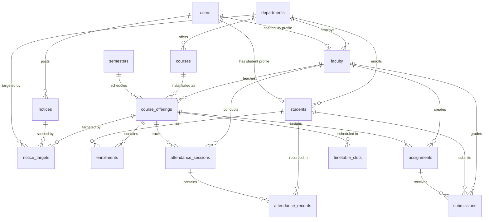

# College Management System — Database Design Document

## 1. Overview

This document defines the normalized relational database architecture for the **College Management System** (PostgreSQL + SQLAlchemy 2.x + Alembic). The schema is designed for a modular monolith backend supporting **Admin**, **Faculty**, and **Student** roles without hardcoding institution-specific structures.

---

## 2. Entity-Relationship Diagram

---

## 3. Entities, Attributes, Constraints & Indexes

### 3.1 User Management

#### `users`
Central identity table for all system actors (Admin, Faculty, Student). Password credentials are excluded in Part 1 and will be added in the authentication phase.
- **Primary Key:** `id` (`INTEGER`)
- **Attributes:**
  - `email`: `VARCHAR(255)`, `NOT NULL`, `UNIQUE`, indexed
  - `full_name`: `VARCHAR(120)`, `NOT NULL`
  - `role`: `ENUM('admin', 'faculty', 'student')` (`user_role`), `NOT NULL`
  - `is_active`: `BOOLEAN`, `NOT NULL`, default `true`
  - `created_at`: `TIMESTAMPTZ`, `NOT NULL`, `server_default=now()`
  - `updated_at`: `TIMESTAMPTZ`, `NOT NULL`, `server_default=now()`

#### `students`
Student-specific profile linked 1-to-1 to `users`.
- **Primary Key:** `id` (`INTEGER`)
- **Foreign Keys:**
  - `user_id` -> `users.id` (`ON DELETE CASCADE`), `NOT NULL`, `UNIQUE`, indexed
  - `department_id` -> `departments.id` (`ON DELETE RESTRICT`), `NOT NULL`, indexed
- **Attributes:**
  - `roll_number`: `VARCHAR(50)`, `NOT NULL`, `UNIQUE`, indexed
  - `admission_year`: `INTEGER`, `NOT NULL`
  - `current_semester_number`: `INTEGER`, `NOT NULL`, default `1`
  - `phone`: `VARCHAR(20)`, `NULL`
  - `date_of_birth`: `DATE`, `NULL`
  - `is_archived`: `BOOLEAN`, `NOT NULL`, default `false`, indexed (soft-delete flag; preserves academic history)
  - `archived_at`: `TIMESTAMPTZ`, `NULL`
  - `archived_by_user_id`: `INTEGER`, `FK -> users.id` (`ON DELETE SET NULL`), `NULL`
  - `created_at`, `updated_at`: `TIMESTAMPTZ`, `NOT NULL`

#### `faculty`
Faculty-specific profile linked 1-to-1 to `users`.
- **Primary Key:** `id` (`INTEGER`)
- **Foreign Keys:**
  - `user_id` -> `users.id` (`ON DELETE CASCADE`), `NOT NULL`, `UNIQUE`, indexed
  - `department_id` -> `departments.id` (`ON DELETE RESTRICT`), `NOT NULL`, indexed
- **Attributes:**
  - `employee_id`: `VARCHAR(50)`, `NOT NULL`, `UNIQUE`, indexed
  - `designation`: `VARCHAR(100)`, `NOT NULL`
  - `phone`: `VARCHAR(20)`, `NULL`
  - `joining_date`: `DATE`, `NULL`
  - `created_at`, `updated_at`: `TIMESTAMPTZ`, `NOT NULL`

---

### 3.2 Academic Structure

#### `departments`
Academic departments (e.g., Computer Science, Mathematics).
- **Primary Key:** `id` (`INTEGER`)
- **Attributes:**
  - `code`: `VARCHAR(20)`, `NOT NULL`, `UNIQUE`, indexed
  - `name`: `VARCHAR(150)`, `NOT NULL`, `UNIQUE`
  - `description`: `TEXT`, `NULL`
  - `created_at`, `updated_at`: `TIMESTAMPTZ`, `NOT NULL`

#### `semesters`
Academic terms/semesters across academic years.
- **Primary Key:** `id` (`INTEGER`)
- **Attributes:**
  - `name`: `VARCHAR(100)`, `NOT NULL`
  - `academic_year`: `VARCHAR(20)`, `NOT NULL`
  - `term_number`: `INTEGER`, `NOT NULL`
  - `start_date`: `DATE`, `NOT NULL`
  - `end_date`: `DATE`, `NOT NULL`
  - `is_active`: `BOOLEAN`, `NOT NULL`, default `false`
  - `created_at`, `updated_at`: `TIMESTAMPTZ`, `NOT NULL`
- **Constraints:**
  - `UQ (academic_year, term_number)` (`uq_semesters_year_term`)
  - `CHECK (end_date > start_date)` (`ck_semesters_dates`)

#### `courses`
Catalog-level course definitions owned by a department.
- **Primary Key:** `id` (`INTEGER`)
- **Foreign Keys:**
  - `department_id` -> `departments.id` (`ON DELETE RESTRICT`), `NOT NULL`, indexed
- **Attributes:**
  - `code`: `VARCHAR(30)`, `NOT NULL`, `UNIQUE`, indexed
  - `title`: `VARCHAR(200)`, `NOT NULL`
  - `credits`: `INTEGER`, `NOT NULL`
  - `description`: `TEXT`, `NULL`
  - `created_at`, `updated_at`: `TIMESTAMPTZ`, `NOT NULL`
- **Constraints:**
  - `CHECK (credits > 0)` (`ck_courses_credits_positive`)

---

### 3.3 Course Management

#### `course_offerings`
A specific offering of a `course` in a `semester`, taught by a `faculty` member for a `section`.
- **Primary Key:** `id` (`INTEGER`)
- **Foreign Keys:**
  - `course_id` -> `courses.id` (`ON DELETE RESTRICT`), `NOT NULL`, indexed
  - `semester_id` -> `semesters.id` (`ON DELETE RESTRICT`), `NOT NULL`, indexed
  - `faculty_id` -> `faculty.id` (`ON DELETE RESTRICT`), `NOT NULL`, indexed
- **Attributes:**
  - `section`: `VARCHAR(20)`, `NOT NULL`, default `'A'`
  - `max_capacity`: `INTEGER`, `NULL`
  - `created_at`, `updated_at`: `TIMESTAMPTZ`, `NOT NULL`
- **Constraints:**
  - `UQ (course_id, semester_id, section)` (`uq_course_offerings_course_sem_section`)

#### `enrollments`
Many-to-many association between `students` and `course_offerings`.
- **Primary Key:** `id` (`INTEGER`)
- **Foreign Keys:**
  - `student_id` -> `students.id` (`ON DELETE CASCADE`), `NOT NULL`, indexed
  - `course_offering_id` -> `course_offerings.id` (`ON DELETE CASCADE`), `NOT NULL`, indexed
- **Attributes:**
  - `status`: `ENUM('enrolled', 'dropped', 'completed')` (`enrollment_status`), `NOT NULL`, default `'enrolled'`
  - `enrolled_at`: `TIMESTAMPTZ`, `NOT NULL`, `server_default=now()`
- **Constraints:**
  - `UQ (student_id, course_offering_id)` (`uq_enrollments_student_offering`)

---

### 3.4 Attendance

#### `attendance_sessions`
A class session held for a `course_offering` on a given date.
- **Primary Key:** `id` (`INTEGER`)
- **Foreign Keys:**
  - `course_offering_id` -> `course_offerings.id` (`ON DELETE CASCADE`), `NOT NULL`, indexed
  - `conducted_by_faculty_id` -> `faculty.id` (`ON DELETE RESTRICT`), `NOT NULL`, indexed
- **Attributes:**
  - `session_date`: `DATE`, `NOT NULL`, indexed
  - `session_number`: `INTEGER`, `NOT NULL`, default `1`
  - `start_time`: `TIME`, `NULL`
  - `topic`: `VARCHAR(200)`, `NULL`
  - `created_at`: `TIMESTAMPTZ`, `NOT NULL`, `server_default=now()`
- **Constraints:**
  - `UQ (course_offering_id, session_date, session_number)` (`uq_attendance_sessions_offering_date_num`)

#### `attendance_records`
Per-student attendance mark for an `attendance_session`.
- **Primary Key:** `id` (`INTEGER`)
- **Foreign Keys:**
  - `session_id` -> `attendance_sessions.id` (`ON DELETE CASCADE`), `NOT NULL`, indexed
  - `student_id` -> `students.id` (`ON DELETE CASCADE`), `NOT NULL`, indexed
- **Attributes:**
  - `status`: `ENUM('present', 'absent', 'late', 'excused')` (`attendance_status`), `NOT NULL`
  - `remarks`: `VARCHAR(255)`, `NULL`
  - `marked_at`: `TIMESTAMPTZ`, `NOT NULL`, `server_default=now()`
- **Constraints:**
  - `UQ (session_id, student_id)` (`uq_attendance_records_session_student`)

---

### 3.5 Assignments

#### `assignments`
Assignments published for a `course_offering`.
- **Primary Key:** `id` (`INTEGER`)
- **Foreign Keys:**
  - `course_offering_id` -> `course_offerings.id` (`ON DELETE CASCADE`), `NOT NULL`, indexed
  - `created_by_faculty_id` -> `faculty.id` (`ON DELETE RESTRICT`), `NOT NULL`, indexed
- **Attributes:**
  - `title`: `VARCHAR(200)`, `NOT NULL`
  - `description`: `TEXT`, `NULL`
  - `due_at`: `TIMESTAMPTZ`, `NOT NULL`, indexed
  - `max_score`: `NUMERIC(6, 2)`, `NOT NULL`, default `100.00`
  - `created_at`, `updated_at`: `TIMESTAMPTZ`, `NOT NULL`
- **Constraints:**
  - `CHECK (max_score > 0)` (`ck_assignments_max_score_positive`)

#### `submissions`
Student submissions and grading for an `assignment`.
- **Primary Key:** `id` (`INTEGER`)
- **Foreign Keys:**
  - `assignment_id` -> `assignments.id` (`ON DELETE CASCADE`), `NOT NULL`, indexed
  - `student_id` -> `students.id` (`ON DELETE CASCADE`), `NOT NULL`, indexed
  - `graded_by_faculty_id` -> `faculty.id` (`ON DELETE SET NULL`), `NULL`
- **Attributes:**
  - `content`: `TEXT`, `NULL`
  - `file_url`: `VARCHAR(500)`, `NULL`
  - `submitted_at`: `TIMESTAMPTZ`, `NOT NULL`, `server_default=now()`
  - `score`: `NUMERIC(6, 2)`, `NULL`
  - `feedback`: `TEXT`, `NULL`
  - `graded_at`: `TIMESTAMPTZ`, `NULL`
- **Constraints:**
  - `UQ (assignment_id, student_id)` (`uq_submissions_assignment_student`)

---

### 3.6 Communication

#### `notices`
Announcements created by authorized users.
- **Primary Key:** `id` (`INTEGER`)
- **Foreign Keys:**
  - `posted_by_user_id` -> `users.id` (`ON DELETE RESTRICT`), `NOT NULL`, indexed
- **Attributes:**
  - `title`: `VARCHAR(200)`, `NOT NULL`
  - `body`: `TEXT`, `NOT NULL`
  - `is_published`: `BOOLEAN`, `NOT NULL`, default `true`
  - `published_at`: `TIMESTAMPTZ`, `NOT NULL`, `server_default=now()`, indexed
  - `expires_at`: `TIMESTAMPTZ`, `NULL`
  - `created_at`, `updated_at`: `TIMESTAMPTZ`, `NOT NULL`

#### `notice_targets`
Audience scoping for a `notice` (by role, department, and/or course offering). `NULL` in a target column indicates "all" for that dimension.
- **Primary Key:** `id` (`INTEGER`)
- **Foreign Keys:**
  - `notice_id` -> `notices.id` (`ON DELETE CASCADE`), `NOT NULL`, indexed
  - `department_id` -> `departments.id` (`ON DELETE CASCADE`), `NULL`, indexed
  - `course_offering_id` -> `course_offerings.id` (`ON DELETE CASCADE`), `NULL`, indexed
- **Attributes:**
  - `target_role`: `ENUM('admin', 'faculty', 'student')` (`user_role`), `NULL`, indexed
- **Constraints:**
  - `UQ (notice_id, target_role, department_id, course_offering_id)` (`uq_notice_targets_scope`)

---

### 3.7 Timetable

#### `timetable_slots`
Weekly recurring schedule slots for a `course_offering`.
- **Primary Key:** `id` (`INTEGER`)
- **Foreign Keys:**
  - `course_offering_id` -> `course_offerings.id` (`ON DELETE CASCADE`), `NOT NULL`, indexed
- **Attributes:**
  - `day_of_week`: `ENUM('monday', 'tuesday', 'wednesday', 'thursday', 'friday', 'saturday', 'sunday')` (`day_of_week`), `NOT NULL`, indexed
  - `start_time`: `TIME`, `NOT NULL`
  - `end_time`: `TIME`, `NOT NULL`
  - `room`: `VARCHAR(50)`, `NULL`
  - `created_at`, `updated_at`: `TIMESTAMPTZ`, `NOT NULL`
- **Constraints:**
  - `CHECK (end_time > start_time)` (`ck_timetable_slots_times`)
  - `UQ (course_offering_id, day_of_week, start_time)` (`uq_timetable_slots_offering_day_start`)

---

## 4. Key Design Decisions & Assumptions

1. **Course vs. Course Offering Separation:** `courses` holds timeless catalog metadata (code, title, credits, department), while `course_offerings` represents a concrete instance in a `semester` with a `section` and `faculty` instructor. Students enroll in `course_offerings`, enabling historical records across academic years.
2. **Attendance Session Uniqueness (`session_number`):** Using `(course_offering_id, session_date, session_number)` with a non-null `session_number` (default `1`) avoids PostgreSQL's default `NULL`-distinct behavior when `start_time` is optional, while still supporting multiple sessions per day (e.g., lecture + lab).
3. **Conservative Cascade Semantics:**
   - `ON DELETE RESTRICT` is used on `departments`, `courses`, `semesters`, and `faculty` references where accidental deletion would destroy historical academic records.
   - `ON DELETE CASCADE` is used for owned child records (`users` -> `students`/`faculty`, `course_offerings` -> `enrollments`/`attendance_sessions`/`assignments`/`timetable_slots`, `attendance_sessions` -> `attendance_records`, `assignments` -> `submissions`, `notices` -> `notice_targets`).
   - `ON DELETE SET NULL` is used for `submissions.graded_by_faculty_id` so student grades survive if a grader record is removed.
4. **No Passwords in Part 1:** `users` intentionally omits `hashed_password` in Part 1; it will be added via an Alembic migration in Part 2 (Authentication).
5. **Institution-Agnostic Academic Structure:** `semesters` uses `academic_year` + `term_number` + `name` rather than hardcoding a fixed 2-semester or 8-semester model.
